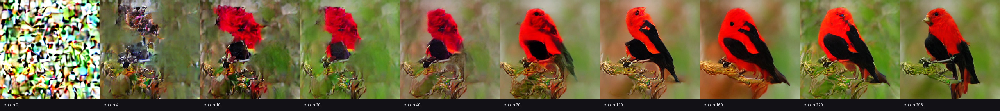
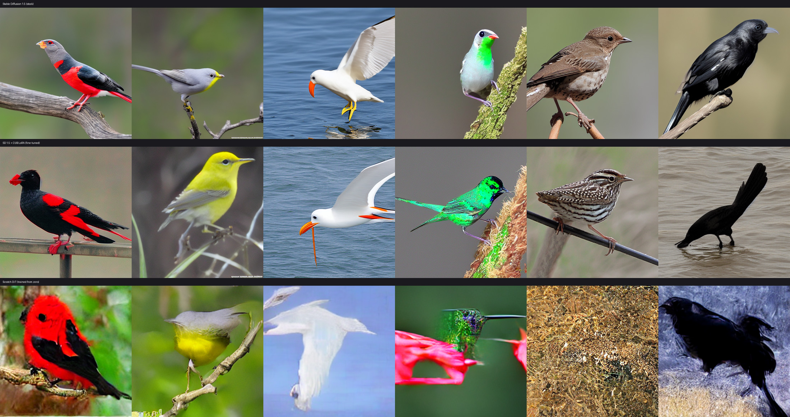
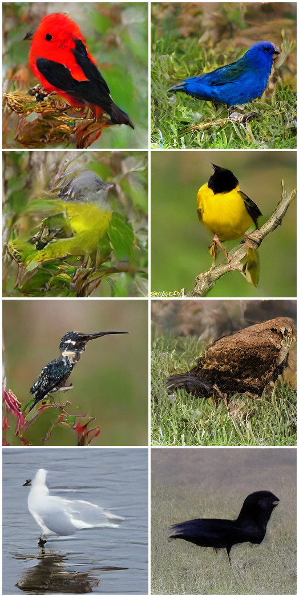
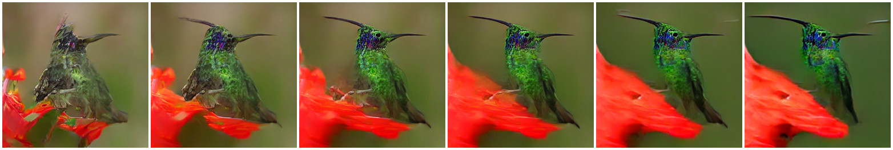
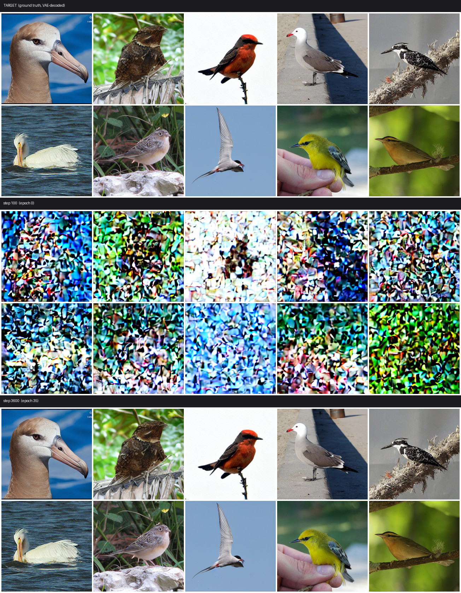
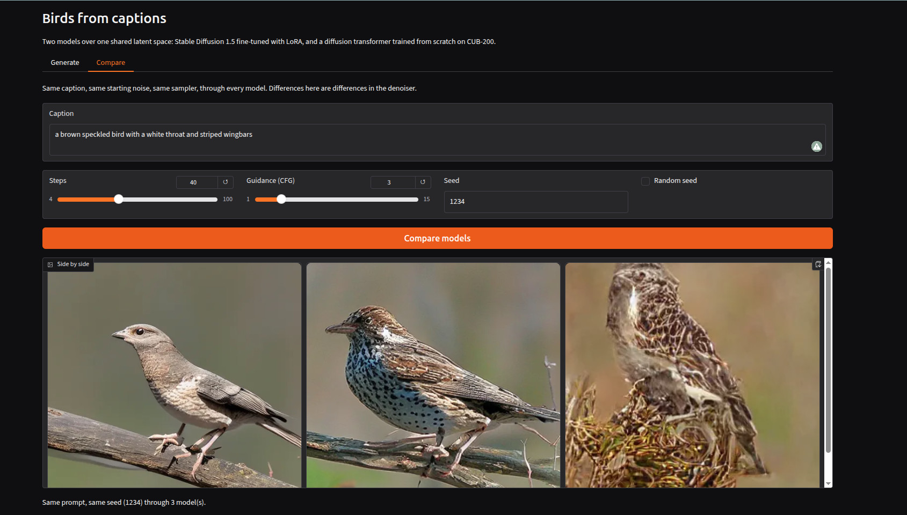

<div align="center">

# Birds from Captions

**A text-to-image diffusion transformer trained from scratch — on one 8 GB laptop GPU.**

[](LICENSE)
[](https://www.python.org/)
[](https://pytorch.org/)
[](https://www.vision.caltech.edu/datasets/cub_200_2011/)
[](documentation/report.pdf)



*The same caption and the same seed, rendered at epochs 0 → 298 as the model learns.
No pretrained denoiser weights. It starts from pure noise and ends with a tanager on a branch.*

</div>

---

## What this is

Two text-to-image models built over **one shared latent space**, trained and evaluated on the
CUB-200-2011 bird dataset:

| | Model | Parameters trained | Time | What it is |
|---|---|---|---|---|
| 🐣 | **Scratch DiT** | 55.6M (all of them) | 9 h 21 m | A diffusion transformer built from nothing — architecture, noise schedule, sampler and guidance all written by hand |
| 🎨 | **SD 1.5 + LoRA** | 3.19M of 862.7M (**0.37 %**) | 1 h 50 m | Stable Diffusion 1.5 adapted to birds with low-rank adapters |

The point of building both was not to pick a winner. It was to find out **what a model trained
from scratch on a narrow domain does differently** from a large pretrained model bent toward that
same domain. The answer turned out to be more interesting than "the big one wins".

## The result, honestly

> **The fine-tune wins on image quality. The from-scratch model wins on caption fidelity.**

<div align="center">


*Same six captions, same starting noise. Top: stock SD 1.5. Middle: SD 1.5 + LoRA. Bottom: the from-scratch DiT.*
</div>

| Model | CLIP score ↑ | Attribute tests passed |
|---|:---:|:---:|
| Stable Diffusion 1.5 (stock) | 0.3053 | — |
| **Stable Diffusion 1.5 + CUB LoRA** | **0.3099** | 2 / 4 |
| Scratch DiT (55.6M) | 0.2920 | **4 / 4** |

The fine-tuned model is sharper, photographic and works at twice the resolution. But Stable
Diffusion carries a powerful prior from hundreds of millions of general images, and that prior
**overrides fine caption detail** — asked for *"a small yellow bird with a **black** head"*, it
renders the yellow head its prior finds most plausible.

The from-scratch model has no such prior. CUB is the only visual world it has ever seen, so it
has nothing to fall back on and follows the caption literally.

<div align="center">


*Each row is one caption pair differing by a **single word**, rendered from identical noise.
Red↔blue belly, grey↔black head, long-thin↔short-thick bill, white↔black bird.*
</div>

## The idea that makes the comparison fair

The expensive, generic parts of a text-to-image system — the image autoencoder and the text
encoder — are **frozen and shared**. Only the denoiser differs.

```
caption ──► CLIP ViT-L/14 (frozen) ─┐
                                    ├──► [ denoiser ] ──► latents ──► SD VAE (frozen) ──► image
noise ──────────────────────────────┘          ▲
                                     ┌─────────┴─────────┐
                                SD 1.5 UNet         Scratch DiT
                                  (+ LoRA)         (flow matching)
```

Because the noise, the conditioning, the sampler and the decoder are all identical, **any
difference in the output is attributable to the denoiser alone**. That is what makes the Compare
tab an experiment rather than an anecdote.

It also pays for itself in practice: one autoencoder on disk instead of two, and the expensive
image-encoding step computed once and reused by both training runs.

## Design decisions worth explaining

**Why Stable Diffusion 1.5 and not SDXL.** SDXL needs roughly 7 GB just to hold its weights,
leaving nothing for training on an 8 GB card. SD 1.5 in half precision needs about 2 GB. That one
fact determined the base model, and through it the latent space and the text encoder.

**Why precompute latents but not text embeddings.** They have opposite cost profiles. Image
latents are expensive to compute and cheap to store (193 MB for the whole dataset). Text
embeddings are the reverse — a CLIP pass takes ~2 ms, but caching 117,880 captions at 77×768
would need **14 GB**, more disk than the machine had. So latents are cached and text is encoded
live. This is what keeps the autoencoder out of VRAM during training, and it is the single reason
training a from-scratch transformer fit on this hardware at all.

**Why rectified flow instead of DDPM.** The path between data and noise is a straight line,
`x_t = (1−t)·x₀ + t·ε`, so the velocity target `ε − x₀` is constant along it. There is no beta
schedule, no cumulative-alpha table and no posterior variance to derive — which removes most of
the places a hand-written diffusion implementation goes quietly wrong. It also means **Euler
integration is exact**, which we verified numerically (see below).

**Why cross-attention rather than pooled conditioning.** Squashing the caption into one vector
would collapse *"red belly and black wings"* into an averaged notion of "bird", and the model
could never learn to put the red on the belly rather than the wings. Attending over all 77 CLIP
tokens is what makes the attribute test above possible.

**Why adaLN-single.** A standard DiT gives every block its own six-way modulation network at
`6d²` parameters each — at d=512, depth 12, that is 19M parameters, *a third of the model*, spent
on timestep conditioning alone. PixArt-α's shared-modulation trick buys that capacity back.

**Why bounding-box cropping.** CUB birds are often small in cluttered frames. Cropping so the bird
fills ~75 % of the frame stops a small model spending its capacity on branches and sky.

## Guidance is a moving target

The most surprising finding of the project. Training previews were rendered at a fixed guidance
scale of 4.0, and late in training they appeared to get **worse** — harsher colour, fragmented
texture — while the loss curves showed no such thing.

<div align="center">


*Guidance 1 → 8, left to right. Muted at 1, crisp at 3, posterised by 6–8.*
</div>

The model had not degraded. **The guidance a model wants falls as it trains**: an under-trained
model needs aggressive extrapolation to produce anything coherent, and a well-trained one
over-shoots at that same scale. The correct operating point is **3.0**, not the 4.0 the previews
had been using. Any fixed preview setting will eventually mislead you about a generative run.

## Verification

The project is built around gates that fail loudly and early, because the dangerous failures in
diffusion are silent — a broken pipeline still produces a smoothly falling loss curve.

| Gate | Check | Result |
|---|---|:---:|
| Latent cache | Cached latents decode back to the source image | **27.15 / 30.77 dB** |
| Flip bookkeeping | Cache index 1 really is the mirror of index 0 | **27.13 / 30.80 dB** |
| Flow sampler | An oracle denoiser recovers the data exactly | **4×10⁻⁸, at 1 step** |
| DDIM sampler | An oracle denoiser recovers the data exactly | **2.4×10⁻⁸** |
| Guidance | Scale 1.0 is bit-identical to unguided | **exact** |
| DiT correctness | Memorises 10 images of 10 distinct species | **loss 1.98 → 0.0034** |

<div align="center">


*The correctness gate. Top: ten targets. Middle: 100 steps. Bottom: 3,600 steps — reconstructed from captions alone.*
</div>

This gate caught two real bugs that produced no error message: DDIM was leaving **2.9 % residual
noise in every Stable Diffusion sample**, and the from-scratch model's timestep embedding had a
dtype mismatch that mixed precision hid during training and revealed only at inference.

## Quick start

```bash
pip install torch diffusers transformers accelerate peft gradio tensorboard

# 1. Download CUB-200-2011 and build the shared latent caches (~35 min, once)
python scripts/prepare_data.py

# 2. Correctness gate — memorise 10 images before spending GPU hours
python scripts/train.py --config-name train_dit overfit=10 run_name=overfit_check

# 3. Train
python scripts/train.py --config-name train_dit     # from scratch, ~9 h
python scripts/train.py --config-name train_lora    # LoRA fine-tune, ~2 h

# 4. Watch (entirely local — no wandb, nothing leaves the machine)
tensorboard --logdir logs/
python scripts/status.py --watch

# 5. Generate and evaluate
python scripts/sample.py model_kind=dit checkpoint=checkpoints/dit_small/last.ckpt mode=sweep_guidance
python scripts/compare_models.py --guidance 3.0 --score

# 6. Launch the app
python app.py
```

Everything is Hydra-configured, so any value can be overridden on the command line:

```bash
python scripts/train.py --config-name train_dit model=dit_base data.batch_size=16
```

> **Note on PyTorch.** This was developed on a Blackwell GPU (`sm_120`), which required a PyTorch
> nightly. If you install into an environment that already has a working torch, run
> `pip install --dry-run ...` first and confirm `torch` is **not** in the install list — a stable
> wheel without your architecture's kernels will silently break the GPU.

## The application

<div align="center">

</div>

A Gradio interface with a **Generate** tab and a **Compare** tab that pushes one caption and one
seed through all three models at once. Only one denoiser is held in VRAM at a time — 8 GB cannot
hold all three.

**The correct guidance differs per model.** The interface default of 4 is wrong for both:

| Model | Guidance | Steps | Images | Why |
|---|:---:|:---:|:---:|---|
| SD 1.5 (stock) | 7.5 | 30 | 2–4 | Native operating point |
| SD 1.5 + LoRA | 7.5 | 30 | 2–4 | Adapters don't change guidance response |
| **Scratch DiT** | **3.0** | 40 | 4–8 | Measured optimum; over-saturates above 4 |

Keep the image count low for the Stable Diffusion variants: classifier-free guidance doubles the
batch internally, so eight images at 512 px means sixteen forward passes through an 860M network,
which exhausts 8 GB. Hold the **seed fixed** when comparing — identical seeds give identical
starting noise, which is the whole point.

## Repository layout

```
configs/            Hydra configs — model, data, diffusion, logger, per-task
ttimg/
  data/             CUB download & index, bbox crop, latent precompute, dataset
  models/           interface.py   the shared Denoiser seam
                    dit.py         the from-scratch transformer
                    sd15.py        Stable Diffusion UNet + LoRA
                    encoders.py    shared frozen VAE and CLIP text encoder
  diffusion/        flow.py        rectified flow objective
                    sampler.py     Euler and DDIM integrators, guidance
  training/         Lightning modules, EMA, sample-grid callback
  eval/             CLIP score
  pipeline.py       caption → image, model-agnostic
scripts/            prepare_data, train, sample, compare_models, status, plot_curves
tests/              oracle tests for both samplers
documentation/      full technical report (PDF + LaTeX source) and all figures
app.py              Gradio interface
```

## Full report

A **28-page technical report** documenting every step, with all figures, derivations and the
engineering faults encountered, is in [`documentation/report.pdf`](documentation/report.pdf)
(LaTeX source alongside it).

## Limitations

The from-scratch model works at 256 px and is visibly softer than Stable Diffusion at 512. It
fails outright on some captions. Its **training loss was still falling when the run was stopped**,
so this compares a converged pretrained model against an under-trained one. Evaluation uses 24
held-out captions, which is a small sample — a proper study would compute FID over the full
validation split. The attribute results come from four caption pairs judged by eye: indicative,
not statistically robust.

## Authors

**Baraa Lazkani** · **Humam Yehia**

Neural Networks course, Faculty of Engineering, Manara University.

## License

Code released under the [MIT License](LICENSE).

The **CUB-200-2011 dataset is not covered by this license** — it is provided by Caltech for
non-commercial research and educational use only. The caption annotations are from Reed et al.
(2016). Stable Diffusion 1.5 weights are subject to the CreativeML Open RAIL-M license.

## Acknowledgements

This work builds directly on ideas from [DiT](https://arxiv.org/abs/2212.09748),
[PixArt-α](https://arxiv.org/abs/2310.00426), [SD3](https://arxiv.org/abs/2403.03206),
[LoRA](https://arxiv.org/abs/2106.09685) and
[Latent Diffusion](https://arxiv.org/abs/2112.10752). Full citations are in the report.
